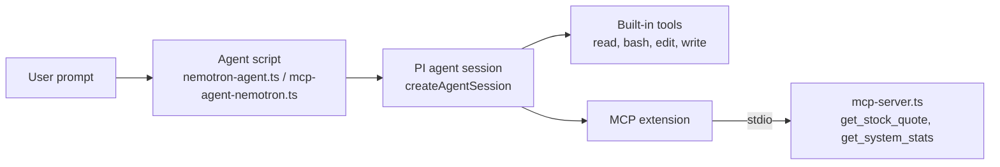

# Agent-Harness-PI

[](LICENSE)


Example harness scripts for the PI coding agent SDK (`@earendil-works/pi-coding-agent`): a minimal agent session, an agent that talks to a local MCP server, a Trivy security-scan agent, and a set of SDK examples.

## Overview

PI Harness is a coding agent that helps users by reading files, executing commands, editing code and writing new files, operating within a controlled environment. This repository contains runnable TypeScript entrypoints that create PI agent sessions programmatically, stream the model output, and log tool calls.

## Features

- **Core coding tools**: the agent can read, bash, edit and write (the default tool set; `trivy-agent.ts` sets it explicitly).
- **Streaming output**: scripts subscribe to session events and print text deltas and tool executions as they happen.
- **MCP integration**: `mcp-agent-nemotron.ts` registers a local stdio MCP server through `createMcpExtension()` and `pi.registerMcpServer()`.
- **Sample MCP server**: `mcp-server.ts` exposes `get_stock_quote` (hard-coded sample prices for NVDA, AAPL, MSFT, GOOGL, random value otherwise, so not live data) and `get_system_stats` (host memory, CPU count, uptime).
- **Skills and extensions**: PI can be extended with skills that provide specialised instructions for specific tasks. See the PI documentation.
- **SDK examples**: 14 numbered examples in `examples/sdk/` (minimal use, custom model, custom prompt, skills, tools, extensions, context files, prompt templates, API keys and OAuth, settings, sessions, full control, session runtime, codemode MCP).

## Architecture



## Prerequisites

- Node.js and npm (the package uses ES modules)
- Access to a model supported by PI. `.env.example` references NVIDIA's OpenAI-compatible endpoint (`https://integrate.api.nvidia.com/v1`); the scripts in this repo do not read these variables themselves, so how PI picks up the model/credentials depends on your PI configuration (TODO: document).

## Quick start

```bash
git clone https://github.com/umesh-khatiwada/Agent-Harness-PI.git
cd Agent-Harness-PI
npm install
cp .env.example .env   # then fill in your own key
npm start              # runs nemotron-agent.ts
```

## Configuration

| Variable | Description |
| --- | --- |
| `OPENAI_BASE_URL` | OpenAI-compatible endpoint, `.env.example` uses NVIDIA's `https://integrate.api.nvidia.com/v1` |
| `OPENAI_API_KEY` | `<your-nvidia-api-key>` |

`.env` is git-ignored. Never commit real keys.

MCP servers can also be declared in `.pi/mcp.json`. The committed entry (`finance`) points at `mcp-server.ts` through an absolute path on the author's machine, so edit it to your local path before use.

## Usage

```bash
# Simple agent; optional prompt as arguments
npm start -- "Summarise the files in this directory"

# Agent with the local MCP server (finance tools)
npm run mcp-agent -- "What is the stock price of NVDA and the system uptime?"

# Trivy agent (interactive, reads prompts from stdin)
npx tsx trivy-agent.ts
```

`trivy-agent.ts` loads whatever MCP servers are configured for PI (via `mcp.json`); a Trivy MCP server entry is not included in this repository's `.pi/mcp.json` (TODO).

Run an SDK example, e.g.:

```bash
npx tsx examples/sdk/01-minimal.ts
```

## Project structure

```
.
├── nemotron-agent.ts        # basic agent session with streaming output
├── mcp-agent-nemotron.ts    # agent + local MCP server
├── mcp-server.ts            # sample stdio MCP server
├── trivy-agent.ts / .js     # Trivy security agent (js is the compiled output)
├── examples/sdk/            # 14 SDK usage examples
├── .pi/mcp.json             # MCP server config
├── .env.example             # placeholder environment variables
├── package.json, tsconfig.json
```

## Development

- `npm test` is a placeholder and fails by design; there are no tests yet.
- `mcp-server.ts` imports `zod`, which is not listed in `package.json` (it resolves transitively via the lockfile). Consider adding it explicitly.

## Roadmap

- [ ] Add real tests
- [ ] Declare `zod` as a dependency
- [ ] Make `.pi/mcp.json` path-independent
- [ ] Document model/credential setup

## License

Released under the [MIT License](LICENSE). Note: `package.json` currently declares `ISC`; align it if desired.

## Author

Umesh Khatiwada - [@umesh-khatiwada](https://github.com/umesh-khatiwada)
